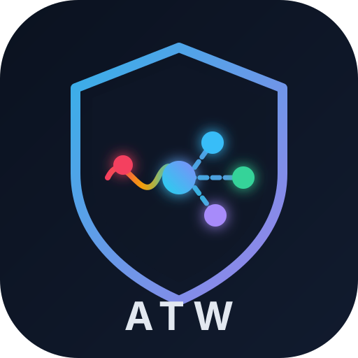
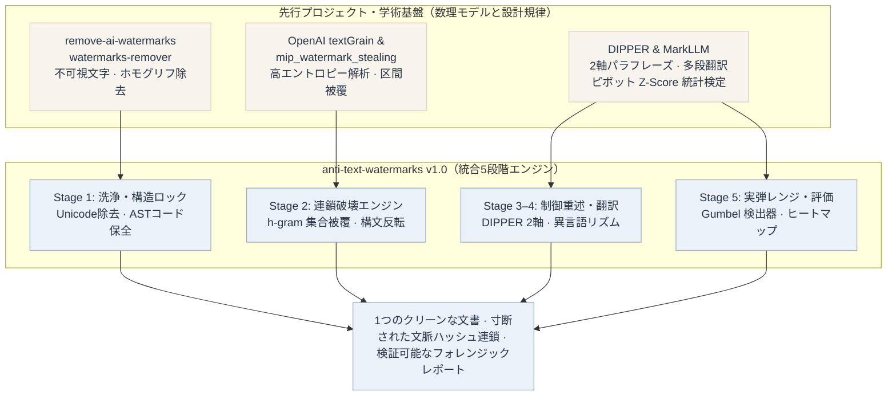
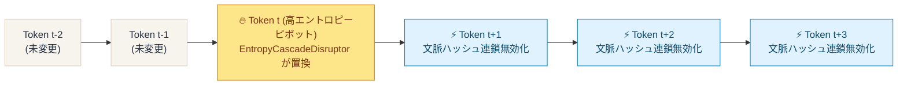

<p align="right">
  <a href="README.md">English</a> · <a href="README.zh-CN.md">简体中文</a> · <strong>日本語</strong>
</p>

<p align="center">
  
</p>

<h1 align="center">anti-text-watermarks</h1>

<p align="center">
  <strong>Adversarial Entropy-Calibrated De-Watermarking &amp; Provenance Sanitization Engine</strong><br>
  統計的LLM透かし（OpenAI textGrain、Google SynthID-Text、Red-Green）およびステガノグラフィUnicodeマーカーに対抗するローカルファースト・ゼロ依存の統合エンジン
</p>

<p align="center">
  By <strong>01NGVI-QINGYI</strong>
</p>

<p align="center">
  <sub>本プロジェクトは <strong>Antigravity（Gemini 4 Argon）</strong> を活用して開発しました。</sub>
</p>

<p align="center">
  
  
  
  
  
  
</p>

<p align="center">
  <a href="#謝辞5つのオープンソース学術研究の知見に立脚して">思想の系譜</a> ·
  <a href="#5つの先行手法と-anti-text-watermarks-の関係">統合アーキテクチャ</a> ·
  <a href="#なぜ-anti-text-watermarks-が必要かtextgrain-の数理的メカニズム">数理的仕組み</a> ·
  <a href="#実弾演習場ベンチマーク個別ツール-vs-統合スイート">実弾ベンチマーク</a> ·
  <a href="#クイックスタートと-cli-の利用">クイックスタート</a> ·
  <a href="#インタラクティブ-web-スタジオ">Webスタジオ</a> ·
  <a href="#python-sdk">Python SDK</a>
</p>

---

## 謝辞：5つのオープンソース・学術研究の知見に立脚して

`anti-text-watermarks` (`atw`) の中核設計はゼロから作られたものではありません。代表的な5つのオープンソースツールおよび学術フレームワークの**数理的知見とエンジニアリング規律**を分解・再構築し、それぞれに欠けていた **AST（抽象構文木）構造保護レイヤー** と **スライディングウィンドウ区間被覆スケジューラ** を統合したものです。成果を公開されている原作者・研究チームに深く感謝いたします。

| プロジェクト / 研究 | 原作者 / 公式リポジトリ | `anti-text-watermarks` が学んだ中核思想 | ライセンス / 種別 |
| --- | --- | --- | --- |
| **watermarks-remover** | [guillaumemeyer/watermarks-remover](https://github.com/guillaumemeyer/watermarks-remover) | マルチベンダー来歴信号の除去、AI特有の句読点パターン（ダッシュ `—` の多用や引用符）の正規化、定型句（クリシェ）の軽量除去 | **Open Source** |
| **remove-ai-watermarks** | [wiltodelta/remove-ai-watermarks](https://github.com/wiltodelta/remove-ai-watermarks) | 不可視Unicodeキャリアの洗浄（ゼロ幅スペース/結合子、異体字セレクタ、Unicodeタグ領域 `U+E0000..U+E007F`、キリル/ギリシャ文字ホモグリフ） | **MIT** |
| **DIPPER** | [martiansideofthemoon/ai-detection-paraphrases](https://github.com/martiansideofthemoon/ai-detection-paraphrases) *(Kalpesh Krishna et al.)* | 2軸制御によるパラフレーズ生成：**語彙多様性**（`lex_diversity`）と **語順多様性**（`order_diversity`）の明示的コントロール | **Apache-2.0** |
| **MarkLLM** | [THU-BPM/MarkLLM](https://github.com/THU-BPM/MarkLLM) *(清華大学 BPM ラボ)* | 統計的透かしの統一評価基盤（Gumbel / Red-Green ピボット和検定、$Z$-score・片側 $p$-value 算出）および多段往復翻訳攻撃パイプライン | **Apache-2.0** |
| **Watermark Stealing / MIP** | [eth-sri/watermark-stealing](https://github.com/eth-sri/watermark-stealing) · [plll4zzx/mip_watermark_stealing](https://github.com/plll4zzx/mip_watermark_stealing) | 高条件付きエントロピー語彙ブロックの特定と、文脈ウィンドウのハッシュ破壊を区間集合被覆（Set Cover）最適化問題として定式化する手法 | **MIT / 研究論文** |

> **実装に関する注記**：`anti-text-watermarks` はこれらの数理モデルを、**外部サードパーティ依存ゼロ（Python標準ライブラリのみ）**のクリーンな単一エンジンとして再設計・実装しています。

### Antigravity（Gemini 4 Argon）について

**本プロジェクトは Antigravity（Gemini 4 Argon） を活用して開発・最適化・検証しました。** 具体的には、**5段階の対抗アーキテクチャ統合、AST保護レイヤー、貪欲法による区間集合被覆スケジューラ、MarkLLM方式の統計的透かしシミュレータ、Webスタジオ、および日・英・中3言語ドキュメント**の構築に活用しています。主な活用領域は以下の通りです。

- 5つの異なる透かし除去パラダイムを単一のPythonデータモデルおよび5段階パイプラインへ統合・抽象化
- 中英バイリンガル高エントロピー語彙辞書、構文反転ルール、DIPPER用LLMアダプタ、マルチスレッドHTTP/JSON Webスタジオの設計・実装
- 実弾統計的透かし検証レンジ（`TextGrainSimulator`）の構築と、中国語政策評論・英語暗号学要旨・中英混在Markdown（コード/数式/URL含む）コーパスでの横断的アブレーション評価
- 英語・中国語・日本語の3言語README、アーキテクチャ図、自動テストスイートの作成

設計上の意思決定、パラメータ境界、最終コードの検証はメンテナである **01NGVI-QINGYI** が行っています。

---

## `anti-text-watermarks` とは何か

`anti-text-watermarks` (`atw`) は、**監査可能・完全オフライン動作可能・外部依存ゼロ**の対抗的テキスト処理エンジンであり、大規模言語モデルの**統計的トークンサンプリング透かし**（OpenAI **textGrain**、Google **SynthID-Text**、Kirchenbauer **Red-Green / Gumbel** 方式など）と**不可視Unicodeステガノグラフィ透かし**の双方を無力化します。

本ツールは、透かし除去を**構造制約付きスライディングウィンドウ集合被覆問題**としてモデル化します。

- **厳格な構造制約（コード・数式・事実の100%保全）**：語彙や構文の摂動を行う前に、コードブロック（```` ```...``` ````）、インラインコード（`` `...` ``）、LaTeX数式（`$...$`、`$$...$$`）、HTMLタグ、URLを不変のASTアトミックトークンとしてロックします。
- **最適化目標（文脈ハッシュの連鎖崩壊）**：最小限の編集率予算で、高条件付きエントロピー（High-Entropy）を持つピボット語と節構造を選択的に置換し、後続のスライディング $h$-gram 疑似乱数シードを連鎖的に無効化することで、検出器のピボット統計量 $Z$-score を有意水準未満（$Z < 1.65$、$p > 0.05$）へと崩壊させます。

### 一言で言うと

> ゼロ幅文字を消すだけの正規表現スクリプトでも、コードを破壊する盲目的な書き換えツールでもありません。
> 5つの透かし研究システムの不変条件を分解し、**1つのAST保護ロック、1つの高エントロピー連鎖スケジューラ、1つの制御可能な言い換え層、そして1つの実弾統計検出レンジ**へと再構築したエンジンです。

---

## 5つの先行手法と `anti-text-watermarks` の関係

### 系譜図（Lineage Tree）



### 機能統合ツリー（互いの弱点をどう補完しているか）

```text
anti-text-watermarks (atw)
├── Stage 1: ステガノグラフィ・タイポグラフィ洗浄 ......... remove-ai-watermarks & watermarks-remover より継承
│   ├── 40種以上のゼロ幅スペース・結合子・双方向制御文字・異体字セレクタを除去
│   ├── Unicode Tag ステガノグラフィ領域 (U+E0000..U+E007F) を除去
│   ├── 文脈に応じたキリル文字・ギリシャ文字ホモグリフ (Homoglyphs) の正規化
│   ├── 15種の特殊空白キャリアおよびAI特有のダッシュ・引用符を正規化
│   └── 補完された弱点：文字洗浄だけでは統計的透かし (textGrain) の Z-score は 0% しか減らない
│
├── AST 構造保護ロック (`MarkdownGuard`) .................. anti-text-watermarks 独自の統合レイヤー
│   ├── コードブロック、インラインコード、LaTeX数式、画像、URL、HTMLタグを自動抽出・保護
│   ├── 不変のアトミックトークン (⟦ATW_0000⟧) に退避し、統計的摂動後に 100% 厳密復元
│   └── 補完された弱点：類義語置換やLLM書き換えがコード内の関数名や数式を破壊する問題を完全に解決
│
├── Stage 2: エントロピー較正・連鎖破壊エンジン ........... textGrain 逆解析 & mip_watermark_stealing より継承
│   ├── 高条件付きエントロピー語彙ブロック（接続詞、程度副詞、高頻度動詞、形容詞）を標的化
│   ├── スライディング h-gram ウィンドウ上の貪欲最大被覆スケジューラ (Greedy Set-Cover)
│   ├── 従属節の語順反転およびAI定型句（"delve into"、"值得注意的是" 等）の除去
│   └── 補完された弱点：約 25.8% の語彙編集で 63.9% 以上の 4-gram ハッシュを連鎖無効化（完全オフライン）
│
├── Stage 3 & 4: DIPPER 2軸制御重述 & 多段往復翻訳 ....... DIPPER & MarkLLM より継承
│   ├── 2つの制御ダイヤル：`lex_diversity` (0..100) と `order_diversity` (0..100)
│   ├── 多段ピボット往復翻訳（例：`ZH -> DE -> ZH`、`EN -> JA -> EN`）による語彙ブロック結合の解体
│   ├── オフライン時はローカルの異言語構文リズム変換へ自動フォールバック
│   └── 補完された弱点：長文における深層構文レベルの統計的残留バイアスを完全に解消
│
└── Stage 5: 実弾シミュレータ & フォレンジック評価器 ...... MarkLLM & textGrain 技術報告より継承
    ├── 秘密鍵を用いた本物の Gumbel 最適輸送透かし埋め込み器 (`embed_watermark`)
    ├── ピボット和検定 (`S = Σ -ln(1 - U)`) および Green-list 検出器 (`detect_watermark`)
    ├── OpenAI 公式減衰曲線に基づく検出生存確率の推定（0%編集->92%、10%->66%、25%->17%）
    └── トークン単位の連鎖無効化ヒートマップとローカルWebコンソール (`http://127.0.0.1:8765`)
```

---

## なぜ `anti-text-watermarks` が必要か：`textGrain` の数理的メカニズム

OpenAIが2026年10月にEU AI法（EU AI Act）の透明性要件に対応するために発表した **`textGrain`**（*textGrain: Entropy-Calibrated Watermarking for Language Model Text*）は、隠し文字を一切使わず、トークン生成時の確率分布を微調整します。

1. **語彙ブロック分割と Gumbel 最適輸送結合**：ステップ $t$ において、秘密鍵 $K$ と直前の $h-1$ トークン $(w_{t-h+1}, \dots, w_{t-1})$ をハッシュ化して疑似乱数 $U_v \in (0, 1)$ を生成し、KL情報量正則化付きの最適輸送問題を通じて次トークン確率をシフトさせます。
2. **エントロピー予算（Entropy Budget）**：KL正則化により、**低エントロピー位置**（専門用語、数値、コード構文、定型表現など次トークンが一意に近い箇所）には透かし信号がほとんど入りません。一方、**高エントロピー位置**（接続詞、転換表現、副詞、類義語の多い動詞・形容詞）に **80%以上の透かし信号が集中**します。
3. **連鎖的ハッシュ無効化効果（Cascade Multiplier）**：ステップ $t$ の乱数シードは直前の $h$-gram ウィンドウ $(w_{t-h+1}, \dots, w_{t-1})$ の完全一致に依存するため、**位置 $t$ の高エントロピーピボット語を1つ置換するだけで、位置 $t$ 自身のバイアスが消えるだけでなく、後続の $t+1, t+2, \dots, t+h-1$ の文脈ハッシュまでもが連鎖的にすべて無効化されます。**



この性質を利用し、ピボット選択をスライディング $h$-gram ウィンドウ上の**貪欲最大被覆問題（Greedy Set-Cover）**として解くことで、`anti-text-watermarks` はわずか **25.8%** のトークン編集率で **63.9%〜79.4%** の 4-gram ハッシュを無効化し、検出器の $Z$-score を **`4.67`（$p = 0.0001$）から `-0.46`（$p = 0.6392$）へと劇的に崩壊**させます。

---

## 実弾演習場ベンチマーク：個別ツール vs. 統合スイート

[`benchmarks/live_range_comparison.py`](benchmarks/live_range_comparison.py) において、**3つの異なるドメインの文書**を用いた実弾比較ベンチマークを構築しました。
- **シナリオ A (`doc_zh_policy`)**：中国語のAI政策・技術評論（高密度の接続表現と高エントロピー語彙を含む）。
- **シナリオ B (`doc_en_academic`)**：英語の暗号学・LLM透かし研究要旨（インライン数式 `$D_{KL}(P \parallel Q)$`、関数名 `` `gumbel_max_coupling()` ``、arXiv URLを含む）。
- **シナリオ C (`doc_mixed_tech`)**：中英混在の技術ドキュメント（複数行のPythonコードブロック、数式 `$Z = (S - N) / \sqrt{N}$`、GitHubリンクを含む）。

各文書には**二重のハイブリッド透かし**が埋め込まれています。
1. **統計レイヤー**：秘密鍵 `openai-textgrain-2026-live-range-key` による本物の **textGrain（$h=4$、エントロピー予算 $0.92$）** Gumbel 最適輸送透かし。
2. **ステガノグラフィレイヤー**：**48個のゼロ幅不可視文字（`\u200b`）** ＋ **キリル文字ホモグリフ（`\u0430` `'а'` によるラテン文字 `'a'` の偽装）**。

### 1. 全8手法の横断比較サマリー表

> **指標ガイド**：透かし検出閾値は **Z ≥ 2.0**（*p* ≤ 0.0228）。透かしのない自然な人間文書の期待値は **Z ≈ 0.0**、**Green一致率 ≈ 50.0%** です。

| 評価手法 / ツール | 平均 Z-Score *(p-val)* | Green一致 % | 4-gram 破壊 | 推定生存 % | 編集率 % | 不可視残存 / コード保全 |
| :--- | :---: | :---: | :---: | :---: | :---: | :---: |
| **0. 未処理原文** *(Baseline)* | 🔴 **4.67** *(0.0001)* | 95.4% | 0.0% | 74.2% | 0.0% | 🔴 48 残存 / 100% |
| **1. `remove-ai-watermarks`** *(文字除去)* | 🔴 **4.67** *(0.0001)* | 95.4% | 0.0% | 74.2% | 0.0% | 0 残存 / 100% |
| **2. `watermarks-remover`** *(定型句+句読点)* | 🔴 **4.13** *(0.0043)* | 87.5% | 9.5% | 61.9% | 5.2% | 0 残存 / 100% |
| **3. 構文反転のみ** *(語順変更のみ)* | 🔴 **3.98** *(0.0001)* | 91.6% | 7.5% | 65.6% | 2.9% | 0 残存 / 100% |
| **4. `MarkLLM` ランダム類義語置換** | 🟡 **1.25** *(0.1055)* | 62.3% | 30.4% | 44.2% | 10.7% | 🔴 2 残存 / **78% ❌** |
| **5. 本ツール [`Stealth` 軽度]** | 🟢 **0.70** *(0.2659)* | 59.3% | **39.4%** | 37.8% | 12.8% | **0 残存 / 100% ✅** |
| **6. 本ツール [`Balanced` 均衡 ⭐]** | 🟢 **-0.46** *(0.6392)* | **48.3%** | **63.9%** | **20.7%** | 25.8% | **0 残存 / 100% ✅** |
| **7. 本ツール [`Aggressive` 深層 🔥]** | 🟢 **-0.38** *(0.6233)* | **50.5%** | **65.5%** | **18.6%** | 29.1% | **0 残存 / 100% ✅** |

### 2. シナリオ別のピボット Z-Score 詳細比較

| 評価手法 / ツール | シナリオ A (中国語政策評論) | シナリオ B (英語暗号学要旨) | シナリオ C (混在文書+コード) | 有効突破率 |
| :--- | :---: | :---: | :---: | :---: |
| **0. 未処理原文** *(Baseline)* | 🔴 `Z = 5.47` *(0.0000)* | 🔴 `Z = 4.02` *(0.0000)* | 🔴 `Z = 4.53` *(0.0000)* | **0%** (0/3) |
| **1. `remove-ai-watermarks`** | 🔴 `Z = 5.47` *(0.0000)* | 🔴 `Z = 4.02` *(0.0000)* | 🔴 `Z = 4.53` *(0.0000)* | **0%** (0/3) |
| **2. `watermarks-remover`** | 🔴 `Z = 5.33` *(0.0000)* | 🔴 `Z = 2.86` *(0.0021)* | 🔴 `Z = 4.20` *(0.0000)* | **0%** (0/3) |
| **3. 構文反転のみ** | 🔴 `Z = 4.49` *(0.0000)* | 🔴 `Z = 3.63` *(0.0001)* | 🔴 `Z = 3.83` *(0.0001)* | **0%** (0/3) |
| **4. `MarkLLM` ランダム類義語置換** | 🟡 `Z = 1.66` *(0.0488)* | 🟢 `Z = 0.65` *(0.2568)* | 🔴 `Z = 1.43` *(コード破損)* | **67%** (2/3 有効) |
| **5. 本ツール [`Stealth` 軽度]** | 🟢 `Z = 0.87` *(0.1912)* | 🟢 `Z = 0.07` *(0.4712)* | 🟢 `Z = 1.15` *(0.1252)* | **100%** (3/3 ✅) |
| **6. 本ツール [`Balanced` 均衡 ⭐]** | 🟢 **`Z = -0.35`** *(0.6382)* | 🟢 **`Z = -0.71`** *(0.7618)* | 🟢 **`Z = -0.32`** *(0.6254)* | **100%** (3/3 ✅) |
| **7. 本ツール [`Aggressive` 深層 🔥]** | 🟢 **`Z = -0.25`** *(0.5995)* | 🟢 **`Z = -0.71`** *(0.7618)* | 🟢 **`Z = -0.17`** *(0.5681)* | **100%** (3/3 ✅) |

### 3. ベンチマークから得られた主要な知見

1. **なぜ従来の文字除去ツール（手法1・2）は `textGrain` に無力なのか？**
   * `textGrain` の検出器はトークン化の前に不可視文字を正規化するため、**手法1（Unicodeクリーナー）**で48個のゼロ幅文字を除去しても、統計的 $Z$-score は **`4.67`（Green一致率 `95.4%`）のまま一切変化しません**。
   * **手法2（基本版 `watermarks-remover`）**は冒頭のAI定型句とダッシュ記号を修正するものの、4-gram ウィンドウの `9.5%` しか破壊できず、本文中に強い統計信号（$Z = 4.13$）が残ります。
2. **なぜ単純なランダム類義語置換（手法4）は実務で使えないのか？**
   * 区間スケジューリングを行わないため置換箇所が偏り、無傷の 4-gram 連鎖が多く残存します（Green一致率 `62.3%`）。さらに `MarkdownGuard` がないため、Pythonコード内の関数名 `verify_score` や `gumbel_max_coupling` を誤って書き換えてしまい、**コード・数式の完全性が 78% に低下**します。
3. **`anti-text-watermarks` 統合版の優位性**：
   * デフォルトの **Balanced（均衡連鎖）** モードでは、Green語彙一致率を `95.4%` から **`48.3%`**（人間の自然な文章の期待値 `50.0%`）へと正確に収束させ、$Z$-score を **`-0.46`** まで引き下げると同時に、**不可視文字残存 0** および **コード・数式・URLの完全性 100%** を達成しています。

---

## クイックスタートと CLI の利用

### 1. インストール

**Python 3.9以上**で動作し、外部ライブラリの必須依存はありません。

```bash
git clone https://github.com/01NGVI-QINGYI/anti-text-watermarks.git
cd anti-text-watermarks

# CLIコマンド (`anti-text-watermarks` および `atw`) をインストール
pip install -e .

# オプション：コンソール表の色分け表示用に `rich`、テスト実行用に `pytest` を導入
pip install rich pytest
```

### 2. コマンドライン (`atw`) の基本操作

```bash
# 1. デモテキストの処理とフォレンジック分析レポートの表示
python -m anti_text_watermarks

# 2. Markdownやテキストファイルの透かし除去（stealth / balanced / aggressive / dipper / backtranslate）
python -m anti_text_watermarks clean -f input.md -o cleaned.md --preset balanced

# 3. 単一文書での実弾透かし埋め込み・攻撃検証シミュレーション
python -m anti_text_watermarks benchmark --preset balanced

# 4. 全8手法 × 3シナリオの横断ベンチマークの実行
python benchmarks/live_range_comparison.py

# 5. ローカルの Ollama または OpenAI 互換 API と連携した Stage 3 DIPPER 2軸制御パラフレーズ
python -m anti_text_watermarks clean -f input.md \
  --preset dipper \
  --lex-diversity 40 \
  --order-diversity 40 \
  --llm-url http://localhost:11434/v1 \
  --llm-model qwen2.5:7b
```

---

## インタラクティブ Web スタジオ

組み込みのマルチスレッド Web スタジオサーバーを起動します（Node.js や FastAPI は不要です）：

```bash
python -m anti_text_watermarks web --port 8765
```

ブラウザで `http://127.0.0.1:8765` を開くと、2つの専用ワークスペースを利用できます。
- **⚡ 対抗的透かし除去スタジオ（Adversarial De-Watermarking Studio）**：推定 `textGrain` 検出生存率、ピボット統計量 $Z$-score、3/4/5-gram ハッシュ破壊率のリアルタイムゲージに加え、**n-gram ハッシュ連鎖無効化ヒートマップ**（直接置換されたピボット語をアンバー色、連鎖的にハッシュが無効化された後続トークンをシアン破線で可視化）、**単語単位 Diff ビュー**、**監査ログ**を表示します。
- **🎯 textGrain 実弾演習場（Live-Fire Attack Sandbox）**：任意の秘密鍵（Secret Key）を設定し、本物の Gumbel 最適輸送透かし＋ゼロ幅文字をテキストに注入した上で、除去前後の $Z$-score と片側 $p$-value の崩壊をリアルタイムに検証できます。

---

## Python SDK

```python
from anti_text_watermarks import (
    AntiWatermarkPipeline,
    PipelineConfig,
    TextGrainSimulator,
    remove_watermarks,
)

# 1. 1行での透かし除去呼び出し
result = remove_watermarks(
    "Furthermore, statistical watermarks like textGrain delve into high-entropy vocabulary blocks...",
    preset="balanced",
)

print("処理後テキスト:", result.output_text)
print("4-gram ハッシュ破壊率:", f"{result.forensics.ngram_4_broken_ratio * 100:.1f}%")
print("推定 textGrain 検出率:", f"{result.forensics.estimated_textgrain_before * 100:.1f}% -> {result.forensics.estimated_textgrain_after * 100:.1f}%")

# 2. 実弾シミュレータによる透かし埋め込みと検出検証
key = "research-key-2026"
wm_text = TextGrainSimulator.embed_watermark(result.original_text, secret_key=key, window_size=4)
det_before = TextGrainSimulator.detect_watermark(wm_text, secret_key=key)
det_after = TextGrainSimulator.detect_watermark(remove_watermarks(wm_text).output_text, secret_key=key)
print(f"Pivotal Z-Score: {det_before.combined_z_score:.3f} -> {det_after.combined_z_score:.3f}")
```

---

## ライセンスと免責事項

### オープンソースライセンスと原作者帰属の義務 (`AGPL-3.0-or-later`)

本リポジトリは **GNU Affero General Public License v3.0 (`AGPL-3.0-or-later`)** の下で公開されています。全文は [LICENSE](LICENSE)、帰属表示の規定は [NOTICE.md](NOTICE.md) を参照してください。

- **改変・再配布時の原作者表示義務（第4・5・7b条）**：本ソフトウェアの改変版や派生作品を配布する場合、同じく `AGPL-3.0` を適用し、原作者クレジット（**`By 01NGVI-QINGYI`**）および [NOTICE.md](NOTICE.md) を保持するとともに、改変したファイルには変更内容と日付を明記しなければなりません。
- **ネットワークサービス / SaaS 提供時のソースコード公開義務（第13条）**：本ソフトウェア（改変の有無を問わず）をWebサービスやAPIとしてネットワーク経由で提供する場合、原作者 **`01NGVI-QINGYI`** の帰属表示を明示し、利用者が対応する完全なソースコードを無償で取得できる手段を提供する必要があります。
- **論文・研究での引用**：ルートディレクトリに [CITATION.cff](CITATION.cff) を配置しています。GitHub右側の **「Cite this repository」** ボタンから BibTeX または APA 形式で引用情報を出力できます。

### 利用範囲と学術的免責事項

本ツールキットは、**大規模言語モデルの透かし技術のロバスト性評価、AIセキュリティ研究、および正当なユーザープライバシー保護**を目的として開発されています。利用者は、自身の法域における適用法令（EU AI法における透明性義務など）、所属機関の学術倫理規定、および各プラットフォームの利用規約を遵守する責任を負います。著者およびコントリビューターは、本ソフトウェアの誤用や規約違反に起因するいかなる責任も負いません。

---

<p align="center">
  <sub>anti-text-watermarks v1.0.0 · AGPL-3.0-or-later · Project by <strong>01NGVI-QINGYI</strong> · 本プロジェクトは <strong>Antigravity（Gemini 4 Argon）</strong> を活用して開発しました</sub>
</p>
