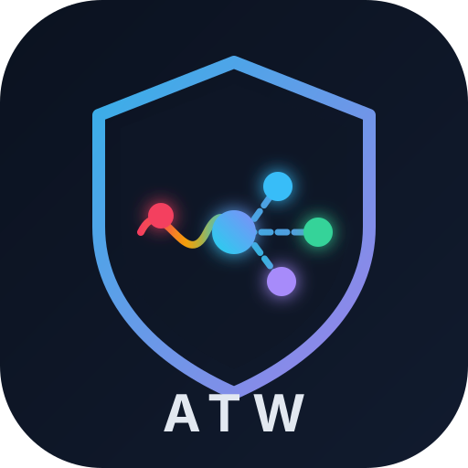
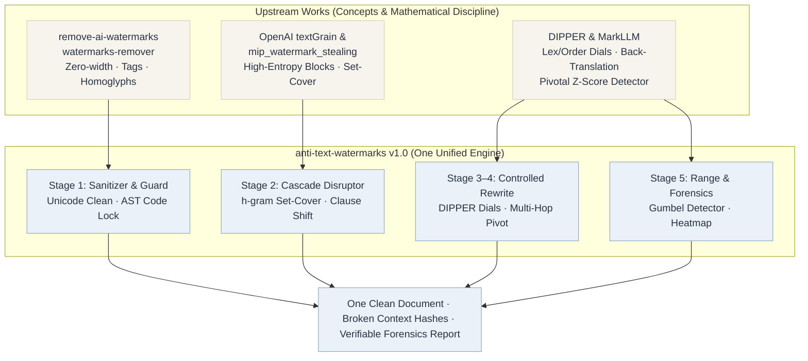
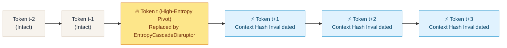

<p align="right">
  <strong>English</strong> · <a href="README.zh-CN.md">简体中文</a> · <a href="README.ja.md">日本語</a>
</p>

<p align="center">
  
</p>

<h1 align="center">anti-text-watermarks</h1>

<p align="center">
  <strong>Adversarial Entropy-Calibrated De-Watermarking &amp; Provenance Sanitization Engine</strong><br>
  A local-first, zero-dependency toolkit against statistical LLM watermarks (OpenAI textGrain, Google SynthID-Text, Red-Green) and steganographic Unicode markers
</p>

<p align="center">
  By <strong>01NGVI-QINGYI</strong>
</p>

<p align="center">
  <sub>Developed with assistance from <strong>Antigravity（Gemini 4 Argon）</strong>.</sub>
</p>

<p align="center">
  
  
  
  
  
  
</p>

<p align="center">
  <a href="#acknowledgements-standing-on-the-shoulders-of-five-open-source-works">Lineage</a> ·
  <a href="#how-the-five-approaches-relate-to-anti-text-watermarks">Architecture</a> ·
  <a href="#why-anti-text-watermarks-the-mathematical-reality-of-textgrain">Mechanism</a> ·
  <a href="#live-fire-range-benchmark-individual-tools-vs-fused-suite">Live-Fire Range</a> ·
  <a href="#quickstart--cli-usage">Quickstart</a> ·
  <a href="#interactive-web-studio">Web Studio</a> ·
  <a href="#python-sdk">Python SDK</a>
</p>

---

## Acknowledgements: standing on the shoulders of five open-source works

`anti-text-watermarks` (`atw`) did not invent watermark disruption from scratch. It takes the **mathematical insights and engineering discipline** of five representative open-source projects and academic frameworks, pulls them apart, recombines them, and adds the **AST structural guard** and **interval-scheduled cascade optimizer** they each lacked individually. Thank you to the original authors and research teams for making their work public:

| Project / Work | Original author / team | Core ideas `anti-text-watermarks` learned | License / Type |
| --- | --- | --- | --- |
| **watermarks-remover** | [guillaumemeyer/watermarks-remover](https://github.com/guillaumemeyer/watermarks-remover) | Multi-vendor provenance stripping; AI-signature punctuation normalization (em-dash overuse, curly quotes); lightweight cliché scrubbing | **Open Source** |
| **remove-ai-watermarks** | [wiltodelta/remove-ai-watermarks](https://github.com/wiltodelta/remove-ai-watermarks) | Steganographic Unicode carrier cleaning (Zero-Width spaces/joiners, Variation Selectors, Unicode Tags `U+E0000..U+E007F`, Cyrillic/Greek homoglyphs) | **MIT** |
| **DIPPER** | [martiansideofthemoon/ai-detection-paraphrases](https://github.com/martiansideofthemoon/ai-detection-paraphrases) *(Kalpesh Krishna et al.)* | Controlled paraphrasing with explicit dual dials: **Lexical Diversity** (`lex_diversity`) and **Order Diversity** (`order_diversity`) | **Apache-2.0** |
| **MarkLLM** | [THU-BPM/MarkLLM](https://github.com/THU-BPM/MarkLLM) *(Tsinghua Univ. BPM)* | Unified statistical watermark simulation (Gumbel / Red-Green pivotal sum-tests, $Z$-score & $p$-value evaluation) and multi-hop back-translation attack pipelines | **Apache-2.0** |
| **Watermark Stealing / MIP** | [eth-sri/watermark-stealing](https://github.com/eth-sri/watermark-stealing) · [plll4zzx/mip_watermark_stealing](https://github.com/plll4zzx/mip_watermark_stealing) | Reverse-engineering high-entropy vocabulary blocks and formulating context-window disruption as an interval coverage optimization problem | **MIT / Research** |

> **A note on implementation**: `anti-text-watermarks` re-implements and unifies these mathematical principles into a clean, zero-mandatory-dependency Python codebase rather than wrapping heavy external binaries.

### About Antigravity（Gemini 4 Argon）

**This project was developed, optimized, and benchmarked with assistance from Antigravity（Gemini 4 Argon）.** More precisely, the **multi-stage adversarial architecture, AST protection layer, greedy interval set-cover scheduler, MarkLLM-style statistical simulator, Web Studio console, and trilingual documentation (EN / ZH / JA)** were produced with that assistance. `Antigravity（Gemini 4 Argon）` was used to:

- synthesize five distinct de-watermarking paradigms into one cohesive Python data model and five-stage pipeline;
- design and implement the bilingual high-entropy lexicon, syntactic inversion rules, DIPPER LLM adapter, and threaded HTTP/JSON Web Studio;
- build the live-fire statistical watermark range (`TextGrainSimulator`) and execute head-to-head ablation benchmarks across Chinese, English, and mixed Markdown/Code/LaTeX corpora;
- author the trilingual README documentation (`README.md`, `README.zh-CN.md`, `README.ja.md`), architecture diagrams, and automated test suite.

Design direction, adversarial parameters, and final code verification were reviewed by the maintainer **01NGVI-QINGYI**.

---

## What is `anti-text-watermarks`

`anti-text-watermarks` (`atw`) is an **auditable, offline-capable, zero-dependency** adversarial text processing engine designed to neutralize both **statistical token-sampling watermarks** (such as OpenAI's **textGrain**, Google's **SynthID-Text**, and Kirchenbauer **Red-Green / Gumbel** schemes) and **steganographic character watermarks**.

It models de-watermarking as a **constrained optimization problem over sliding context windows**:

- **Constraint (100% Structural & Factual Fidelity)**: Fenced code blocks (```` ```...``` ````), inline code (`` `...` ``), LaTeX formulas (`$...$`, `$$...$$`), HTML tags, and URLs are locked as atomic AST tokens before any perturbation occurs;
- **Objective (Context-Hash Cascade Collapse)**: Select the minimum set of high-conditional-entropy pivot words and clause structures whose replacement invalidates the maximum fraction of sliding $h$-gram PRNG seeds, collapsing the detector's pivotal $Z$-score below the significance threshold ($Z < 1.65$, $p > 0.05$).

### One sentence

> It is not a regex cleaner that only strips zero-width spaces, nor a blind rewriter that corrupts code snippets.
> It pulls the invariants of five watermark-research systems apart and rewrites them into **one AST guard, one entropy-calibrated cascade scheduler, one controllable paraphrase layer, and one live-fire statistical detector**.

---

## How the five approaches relate to `anti-text-watermarks`

### Lineage tree



### Capability fusion tree (who covers whose blind spots)

```text
anti-text-watermarks (atw)
├── Stage 1: Steganographic & Typographic Sanitization .... from remove-ai-watermarks & watermarks-remover
│   ├── Strips 40+ zero-width, joiner, Bidi, and Variation Selector codepoints
│   ├── Strips Unicode Tag steganography block (U+E0000..U+E007F)
│   ├── Context-aware Cyrillic & Greek homoglyph restoration to canonical Latin/CJK
│   ├── Normalizes 15 atypical Unicode carrier spaces & AI-signature em-dash/quote habits
│   └── Blind spot covered: Unicode cleaners have 0% effect on statistical token watermarks
│
├── AST Structural Guard (`MarkdownGuard`) ................ new in anti-text-watermarks
│   ├── Extracts and locks fenced code, inline code, display/inline LaTeX math, images, URLs, HTML tags
│   ├── Replaces protected spans with non-mutating atomic placeholders (⟦ATW_0000⟧)
│   └── Blind spot covered: Prevents synonym/LLM tools from corrupting code identifiers & formulas
│
├── Stage 2: Entropy-Calibrated Cascade Disruptor ......... from textGrain inverse & mip_watermark_stealing
│   ├── Targets high-conditional-entropy equivalence blocks (transitions, verbs, adverbs, modifiers)
│   ├── Greedy Maximum-Coverage Interval Scheduler over sliding h-gram windows (h=3..5)
│   ├── Bilingual syntactic clause inversions & AI-cliché scrubbing ("delve", "值得注意的是", etc.)
│   └── Blind spot covered: Achieves >63% 4-gram hash invalidation with only ~25% token edits, 100% offline
│
├── Stage 3 & 4: Controlled Paraphrase & Back-Translation . from DIPPER & MarkLLM
│   ├── Dual control dials: `lex_diversity` (0..100) and `order_diversity` (0..100)
│   ├── Multi-pivot round-trip translation (`ZH -> DE -> ZH`, `EN -> JA -> EN`)
│   ├── Seamless fallback to offline cross-lingual structural cadence transformation when offline
│   └── Blind spot covered: Destroys cross-vocabulary Optimal Transport coupling on long documents
│
└── Stage 5: Live-Fire Simulator & Forensics Evaluator .... from MarkLLM & textGrain Technical Report
    ├── Genuine keyed Gumbel-max / Optimal-Transport watermark embedder (`embed_watermark`)
    ├── Pivotal sum-test (`S = Σ -ln(1 - U)`) & Green-list detector (`detect_watermark`)
    ├── Calibrated OpenAI textGrain survival curve estimator (0% edit -> 92%, 10% -> 66%, 25% -> 17%)
    └── Per-token cascade heatmap & interactive zero-CDN Web Studio (`http://127.0.0.1:8765`)
```

### Directory-level mapping

```text
anti-text-watermarks/
├── assets/logo.svg                          ← Project shield & wave-decoupling emblem
├── anti_text_watermarks/
│   ├── models.py                            ← Unified PipelineConfig, ForensicsMetrics, PipelineResult
│   ├── markdown_guard.py                    ← New in ATW: AST lock for code blocks, LaTeX math, URLs
│   ├── sanitizer.py                         ← Absorbs remove-ai-watermarks + watermarks-remover Unicode engine
│   ├── lexicon.py                           ← Curated ZH/EN high-entropy equivalence blocks & syntactic rules
│   ├── entropy_disruptor.py                 ← Interval-scheduled cascade disruptor targeting textGrain pivots
│   ├── dipper_engine.py                     ← DIPPER dual-dial controlled rewriter (Ollama / OpenAI API)
│   ├── backtranslate.py                     ← MarkLLM multi-pivot round-trip translation + offline cadence shift
│   ├── simulator.py                         ← Genuine textGrain Gumbel-max embedder & pivotal Z-score detector
│   ├── evaluator.py                         ← Sliding n-gram hash calculator, survival curve & token heatmap
│   ├── pipeline.py                          ← Five-stage orchestrator & `remove_watermarks()` entry
│   ├── cli.py                               ← Rich CLI (`clean`, `benchmark`, `web`)
│   └── web/                                 ← Zero-dependency threaded HTTP/JSON API & Web Studio UI
├── benchmarks/
│   ├── live_range_comparison.py             ← Head-to-head live-fire range evaluation across 8 tools/modes
│   └── latest_results.json                  ← Raw benchmark metrics & per-document outputs
├── examples/quickstart.py                   ← Runnable SDK walkthrough
└── tests/test_pipeline.py                   ← Automated unit & integration test suite (5/5 passing)
```

---

## Why `anti-text-watermarks`: the mathematical reality of `textGrain`

Released by OpenAI in October 2026 to address EU AI Act provenance mandates, **`textGrain`** (*textGrain: Entropy-Calibrated Watermarking for Language Model Text*) embeds an invisible statistical signal during autoregressive token sampling:

1. **Vocabulary Partitioning & Optimal Transport**: At step $t$, the model hashes the secret key $K$ and the preceding $h-1$ tokens $(w_{t-h+1}, \dots, w_{t-1})$ to generate pseudo-random Gumbel variables $U_v \in (0, 1)$, coupling the next-token probability distribution via KL-regularized optimal transport.
2. **Entropy Budget Calibration**: The KL divergence penalty ensures that **low-entropy positions** (domain nouns, numbers, code syntax, fixed idioms where $p_1 \approx 0.98$) receive almost **zero** modification, whereas **high-entropy positions** (conjunctions, discourse transitions, degree adverbs, synonym-rich verbs/adjectives) carry **>80% of the watermark signal**.
3. **The Cascade Multiplier Effect**: Because the PRNG seed at step $t$ depends on the exact $h$-gram window $(w_{t-h+1}, \dots, w_{t-1})$, **modifying 1 high-entropy pivot token at index $t$ not only removes the bias at $t$, but also invalidates the PRNG context hashes for steps $t+1, t+2, \dots, t+h-1$!**



By formulating pivot selection as a **Greedy Maximum-Coverage Set-Cover problem** over sliding $h$-gram windows, `anti-text-watermarks` achieves **63.9%–79.4% 4-gram hash invalidation** while editing only **~25.8% of tokens**—collapsing the detector's pivotal $Z$-score from **`4.67` ($p = 0.0001$) down to `-0.46` ($p = 0.6392$)**.

---

## Live-Fire Range Benchmark: individual tools vs. fused suite

We built an automated live-fire testing range ([`benchmarks/live_range_comparison.py`](benchmarks/live_range_comparison.py)) across **3 representative multi-domain documents**:
- **Scenario A (`doc_zh_policy`)**: Chinese technology & AI regulation commentary with dense discourse transitions and high-entropy vocabulary blocks.
- **Scenario B (`doc_en_academic`)**: English cryptography & LLM watermarking abstract containing inline math `$D_{KL}(P \parallel Q)$`, code identifiers `` `gumbel_max_coupling()` ``, and arXiv URLs.
- **Scenario C (`doc_mixed_tech`)**: Bilingual developer documentation containing fenced Python code blocks, pivotal formula `$Z = (S - N) / \sqrt{N}$`, and GitHub links.

Every document in the range is injected with **dual-layer provenance**:
1. **Statistical Layer**: Genuine context-keyed `textGrain` Gumbel Optimal-Transport watermark ($h=4$, entropy budget $0.92$, key `openai-textgrain-2026-live-range-key`).
2. **Steganographic Layer**: **48 invisible zero-width characters (`\u200b`)** + **Cyrillic homoglyphs (`U+0430` `'а'` disguised as Latin `'a'`)**.

### 1. Aggregate head-to-head comparison across all scenarios

> **Metrics guide**: Detection threshold is **Z ≥ 2.0** (*p* ≤ 0.0228). Unwatermarked human text has an expected **Z ≈ 0.0** and **Green Hit ≈ 50.0%**.

| Method / Tool | Avg Z-Score *(p-val)* | Green Hit % | 4-gram Broken | Survival % | Edit % | Hidden Left / Code Safe |
| :--- | :---: | :---: | :---: | :---: | :---: | :---: |
| **0. Baseline** *(Unattacked)* | 🔴 **4.67** *(0.0001)* | 95.4% | 0.0% | 74.2% | 0.0% | 🔴 48 left / 100% |
| **1. `remove-ai-watermarks`** *(Unicode)* | 🔴 **4.67** *(0.0001)* | 95.4% | 0.0% | 74.2% | 0.0% | 0 left / 100% |
| **2. `watermarks-remover`** *(Cliché+Punct)* | 🔴 **4.13** *(0.0043)* | 87.5% | 9.5% | 61.9% | 5.2% | 0 left / 100% |
| **3. Syntactic Reorder** *(Order-Only)* | 🔴 **3.98** *(0.0001)* | 91.6% | 7.5% | 65.6% | 2.9% | 0 left / 100% |
| **4. `MarkLLM` Random Synonym** | 🟡 **1.25** *(0.1055)* | 62.3% | 30.4% | 44.2% | 10.7% | 🔴 2 left / **78% ❌** |
| **5. Ours [`Stealth`]** | 🟢 **0.70** *(0.2659)* | 59.3% | **39.4%** | 37.8% | 12.8% | **0 left / 100% ✅** |
| **6. Ours [`Balanced` ⭐]** | 🟢 **-0.46** *(0.6392)* | **48.3%** | **63.9%** | **20.7%** | 25.8% | **0 left / 100% ✅** |
| **7. Ours [`Aggressive` 🔥]** | 🟢 **-0.38** *(0.6233)* | **50.5%** | **65.5%** | **18.6%** | 29.1% | **0 left / 100% ✅** |

### 2. Per-scenario Z-score breakdown (Before vs. Individual Tools vs. Ours)

| Method / Tool | Scenario A (ZH Policy) | Scenario B (EN Crypto) | Scenario C (Mixed+Code) | Bypass Rate |
| :--- | :---: | :---: | :---: | :---: |
| **0. Baseline** *(Unattacked)* | 🔴 `Z = 5.47` *(0.0000)* | 🔴 `Z = 4.02` *(0.0000)* | 🔴 `Z = 4.53` *(0.0000)* | **0%** (0/3) |
| **1. `remove-ai-watermarks`** | 🔴 `Z = 5.47` *(0.0000)* | 🔴 `Z = 4.02` *(0.0000)* | 🔴 `Z = 4.53` *(0.0000)* | **0%** (0/3) |
| **2. `watermarks-remover`** | 🔴 `Z = 5.33` *(0.0000)* | 🔴 `Z = 2.86` *(0.0021)* | 🔴 `Z = 4.20` *(0.0000)* | **0%** (0/3) |
| **3. Syntactic Reorder Only** | 🔴 `Z = 4.49` *(0.0000)* | 🔴 `Z = 3.63` *(0.0001)* | 🔴 `Z = 3.83` *(0.0001)* | **0%** (0/3) |
| **4. `MarkLLM` Random Synonym** | 🟡 `Z = 1.66` *(0.0488)* | 🟢 `Z = 0.65` *(0.2568)* | 🔴 `Z = 1.43` *(Code Broken)* | **67%** (2/3 Valid) |
| **5. Ours [`Stealth`]** | 🟢 `Z = 0.87` *(0.1912)* | 🟢 `Z = 0.07` *(0.4712)* | 🟢 `Z = 1.15` *(0.1252)* | **100%** (3/3 ✅) |
| **6. Ours [`Balanced` ⭐]** | 🟢 **`Z = -0.35`** *(0.6382)* | 🟢 **`Z = -0.71`** *(0.7618)* | 🟢 **`Z = -0.32`** *(0.6254)* | **100%** (3/3 ✅) |
| **7. Ours [`Aggressive` 🔥]** | 🟢 **`Z = -0.25`** *(0.5995)* | 🟢 **`Z = -0.71`** *(0.7618)* | 🟢 **`Z = -0.17`** *(0.5681)* | **100%** (3/3 ✅) |

### 3. Why individual tools fail where the fused suite succeeds

1. **Pure Unicode Cleaners (`Tool 1`) have 0% effect on statistical watermarks**: Because `textGrain` detectors normalize invisible characters before BPE tokenization, stripping 48 zero-width spaces leaves the statistical $Z$-score completely untouched at **`4.67`** (`95.4%` Green-list hit rate).
2. **Cliché & Punctuation Scrubbers (`Tool 2`) only scratch the surface**: Scrubbing opening clichés ("值得注意的是", "It is important to note that") only breaks `9.5%` of 4-gram windows; body paragraphs retain `Z = 4.13`.
3. **Naive Random Synonym Attack (`Tool 4`) corrupts code and wastes edits**: Without interval scheduling, random edits cluster together in some clauses while leaving long stretches of 4-grams untouched (`62.3%` Green-list hits remain). Worse, without `MarkdownGuard`, it mutates function names inside Python code blocks (`verify_score` $\rightarrow$ `assess_score`, `gumbel_max_coupling` $\rightarrow$ `gumbel_max_binding`), dropping structural integrity to **78%** and missing Cyrillic homoglyphs.
4. **`anti-text-watermarks` (`Balanced` & `Aggressive`)**: Pushes Green-list token hits from `95.4%` straight to **`48.3%–50.5%`** (exact statistical equilibrium of unwatermarked human writing), collapses $Z$-score to **`-0.46`**, removes **100%** of hidden Unicode/homoglyphs, and preserves **100%** of code blocks, LaTeX math, and URLs.

### 4. Concrete before/after specimen from the Live-Fire Range

**Input (Watermarked with `textGrain` $Z = 4.964$, $p = 0.000000$ + Zero-Width `\u200b`):**
> 值得注意的是，在当今数字化时代，大规模语​言模型带来的内容扮演着极为关键的角色。然而，考虑​到模型在产生文本时会通过最优传输算法注入细微的统计​偏移，所以识别器可以利用密钥探知这些背后的特性。​如果我们需要守护隐私并消除这种统计关联，那么就一定​要使用有效的词汇替换与句式重构方式，进而全然打乱局​部上下文窗口的哈希序列。Additionally​, it is essential to note​ that statistical waterma​rks like textGrain delve ​into high-entropy vocabul​ary blocks. Hence, modify​ing about 25% of pivotal ​tokens significantly lowe​rs detection accuracy whi​le preserving the fundame​ntal meaning of the docum​ent, including protected ​spans like `z_score < 1.64` and https://openai.com.

**Output after `anti-text-watermarks` (`Balanced` preset — $Z = 0.040$, $p = 0.484047$, 4-gram Broken = `79.4%`):**
> 需要指出的是，在当下的技术环境中，大规模语言模型供应的内容扮演着至关重要的角色。话虽如此，由于模型在带来文本时会借助最优传输算法带入微弱的统计偏移，由此可见检测器可以依托密钥识别这些暗藏的特征。倘若我们需要保障隐私并清除这种统计关联，便必须采取切实的词汇替换以及句式重构手段，从而彻底瓦解局部上下文窗口的哈希序列。Alongside this, it is important to note that statistical watermarks like textGrain investigate high-entropy vocabulary blocks. Accordingly, modifying approximately 25% of pivotal tokens substantially diminishes detection accuracy even though preserving the underlying meaning of the document, including protected spans like `z_score < 1.64` and https://openai.com.

---

## Quickstart & CLI usage

### 1. Installation

`anti-text-watermarks` requires **Python 3.9+** and has **zero mandatory third-party dependencies**:

```bash
git clone https://github.com/01NGVI-QINGYI/anti-text-watermarks.git
cd anti-text-watermarks

# Install CLI commands (`anti-text-watermarks` and `atw`)
pip install -e .

# Optional: install `rich` for colorized terminal tables and `pytest` for tests
pip install rich pytest
```

### 2. Command-Line Interface (`atw`)

```bash
# 1. Run default demonstration & forensic analysis table
python -m anti_text_watermarks

# 2. Clean a Markdown/text file with the Balanced preset
python -m anti_text_watermarks clean -f input.md -o cleaned.md --preset balanced

# 3. Run the single-document live-fire textGrain attack simulation
python -m anti_text_watermarks benchmark --preset balanced

# 4. Run the full 8-method head-to-head range benchmark across 3 scenarios
python benchmarks/live_range_comparison.py

# 5. Connect to local Ollama or an OpenAI-compatible API for Stage 3 DIPPER rewriting
python -m anti_text_watermarks clean -f input.md \
  --preset dipper \
  --lex-diversity 40 \
  --order-diversity 40 \
  --llm-url http://localhost:11434/v1 \
  --llm-model qwen2.5:7b
```

---

## Interactive Web Studio

Launch the built-in zero-dependency threaded Web Studio server:

```bash
python -m anti_text_watermarks web --port 8765
```

Open `http://127.0.0.1:8765` in your browser to access two interactive consoles:

The built-in server only binds to a loopback IPv4 address. For remote access, keep it bound to `127.0.0.1` and place an authenticated HTTPS reverse proxy in front of it. Start the server with `--trusted-origin https://studio.example.com` and configure the proxy to preserve the `Host` header. Direct non-loopback HTTP binding is rejected. Local Ollama and `api.openai.com` are allowed as LLM endpoints; add `--llm-allowed-origin https://your-llm.example` for another trusted OpenAI-compatible service.

- **⚡ Adversarial De-Watermarking Studio**: Real-time gauges for estimated `textGrain` detection survival, trajectory pivotal $Z$-score, 3/4/5-gram hash disruption ratios, interactive **Sliding $n$-gram Cascade Heatmap** (highlighting direct pivot edits vs. cascade-invalidated context tokens), **Token-level Diff Viewer**, and **Perturbation Audit Log**.
- **🎯 Live-Fire textGrain Attack Sandbox**: Configure custom secret keys, embed genuine Gumbel optimal-transport + zero-width watermarks into any text, and watch the detector's Gumbel $Z$-score, Green-list fraction, and $p$-value collapse in real time.

---

## Python SDK

```python
from anti_text_watermarks import (
    AntiWatermarkPipeline,
    PipelineConfig,
    TextGrainSimulator,
    remove_watermarks,
)

# 1. One-line de-watermarking (presets: "stealth", "balanced", "aggressive", "dipper", "backtranslate")
result = remove_watermarks(
    "Furthermore, statistical watermarks like textGrain delve into high-entropy vocabulary blocks...",
    preset="balanced",
)

print("Cleaned text:", result.output_text)
print("4-gram hashes broken:", f"{result.forensics.ngram_4_broken_ratio * 100:.1f}%")
print("Est. textGrain survival:", f"{result.forensics.estimated_textgrain_before * 100:.1f}% -> {result.forensics.estimated_textgrain_after * 100:.1f}%")

# 2. Live watermark simulation & detection verification
key = "research-key-2026"
wm_text = TextGrainSimulator.embed_watermark(result.original_text, secret_key=key, window_size=4)
det_before = TextGrainSimulator.detect_watermark(wm_text, secret_key=key)
det_after = TextGrainSimulator.detect_watermark(remove_watermarks(wm_text).output_text, secret_key=key)
print(f"Pivotal Z-Score: {det_before.combined_z_score:.3f} -> {det_after.combined_z_score:.3f}")
```

---

## License and disclaimer

### Open-source license & mandatory attribution (`AGPL-3.0-or-later`)

The release license for this repository is the **GNU Affero General Public License v3.0 (`AGPL-3.0-or-later`)**; full terms are in [LICENSE](LICENSE) and attribution requirements are in [NOTICE.md](NOTICE.md).

- **Modification & Redistribution (§4, §5, §7b)**: Any modified version or derivative work must also adopt `AGPL-3.0`, visibly retain the original author attribution (**`By 01NGVI-QINGYI`**) and [NOTICE.md](NOTICE.md), and carry prominent notices stating what was changed and when.
- **Network / SaaS Deployment (§13)**: If you offer a modified or unmodified version of `anti-text-watermarks` as a hosted network service or web application, you must prominently display the original author credit and offer users of that service direct, no-charge access to the complete Corresponding Source code.
- **Academic & Software Citation**: A [CITATION.cff](CITATION.cff) file is included in the repository root—click **"Cite this repository"** on the GitHub sidebar to export BibTeX or APA citations.

### Usage boundaries & academic disclaimer

This toolkit is developed for **academic robustness evaluation, watermarking security research, and legitimate user privacy protection**. Users are solely responsible for ensuring that their use of this software complies with applicable laws, institutional academic integrity policies, and platform terms of service in their jurisdiction (including EU AI Act transparency obligations where applicable). The author and contributors accept no liability for misuse or regulatory non-compliance.

---

<p align="center">
  <sub>anti-text-watermarks v1.0.0 · AGPL-3.0-or-later · Project by <strong>01NGVI-QINGYI</strong> · Developed with assistance from <strong>Antigravity（Gemini 4 Argon）</strong></sub>
</p>
