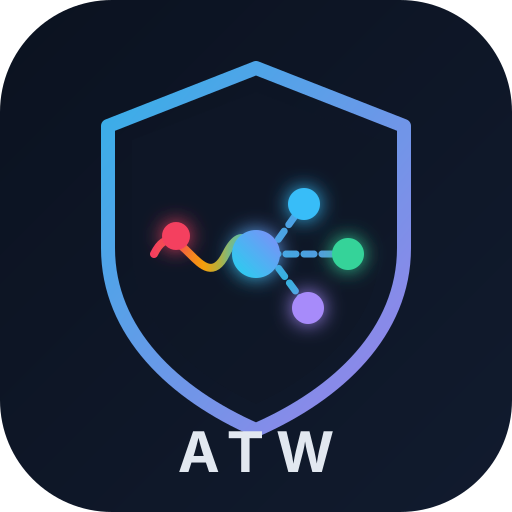
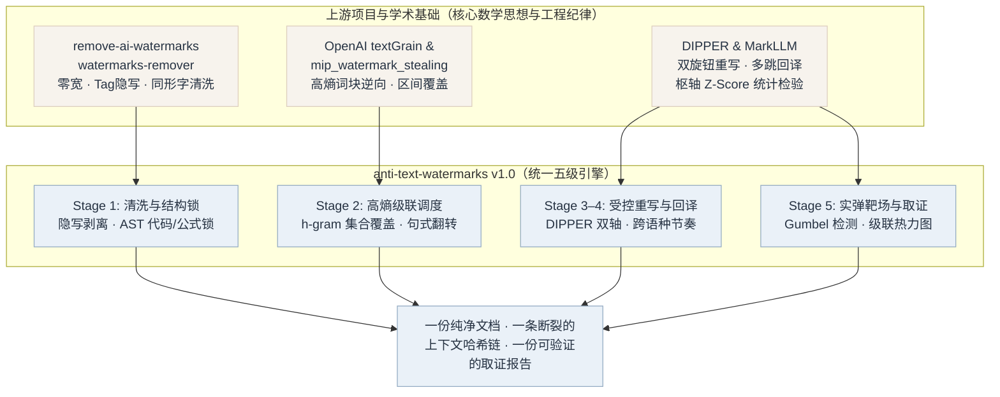
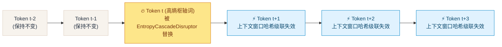

<p align="right">
  <a href="README.md">English</a> · <strong>简体中文</strong> · <a href="README.ja.md">日本語</a>
</p>

<p align="center">
  
</p>

<h1 align="center">anti-text-watermarks</h1>

<p align="center">
  <strong>Adversarial Entropy-Calibrated De-Watermarking &amp; Provenance Sanitization Engine</strong><br>
  面向统计采样水印（OpenAI textGrain、Google SynthID-Text、Red-Green）与隐写 Unicode 标记的本地优先、零依赖综合对抗引擎
</p>

<p align="center">
  By <strong>01NGVI-QINGYI</strong>
</p>

<p align="center">
  <sub>本项目使用 <strong>Antigravity（Gemini 4 Argon）</strong> 辅助开发。</sub>
</p>

<p align="center">
  
  
  
  
  
  
</p>

<p align="center">
  <a href="#致谢站在五个开源与学术项目的肩膀上">思想源流</a> ·
  <a href="#五个上游方案与-anti-text-watermarks-的关系">融合架构</a> ·
  <a href="#为什么需要-anti-text-watermarkstextgrain-的数学真相">核心机理</a> ·
  <a href="#实弹靶场横向对比评测单一工具-vs-融合版套件">实弹靶场评测</a> ·
  <a href="#快速开始与-cli-命令">快速开始</a> ·
  <a href="#交互式-web-可视化工作台">Web 工作台</a> ·
  <a href="#python-sdk-调用">Python SDK</a>
</p>

---

## 致谢：站在五个开源与学术项目的肩膀上

`anti-text-watermarks` (`atw`) 的核心设计并非凭空捏造，而是把五个最具代表性的去水印开源工具与学术框架的**数学思想与工程纪律**拆开、重组，再补上它们各自缺失的 **AST 结构锁定保护层** 与 **滑动窗口区间覆盖级联调度器**。感谢原作者与研究团队公开这些成果：

| 项目 / 研究 | 原作者 / 官方仓库 | `anti-text-watermarks` 从中学习的核心思想 | 许可证 / 类型 |
| --- | --- | --- | --- |
| **watermarks-remover** | [guillaumemeyer/watermarks-remover](https://github.com/guillaumemeyer/watermarks-remover) | 跨厂商溯源信号剥离；AI 典型标点习惯规范化（破折号 `—` 滥用、弯引号标准化）；轻量级高频套话擦除 | **开源项目** |
| **remove-ai-watermarks** | [wiltodelta/remove-ai-watermarks](https://github.com/wiltodelta/remove-ai-watermarks) | 隐写 Unicode 载体清洗（零宽空格/连接符、变体选择符、Unicode Tag 块 `U+E0000..U+E007F`、西里尔/希腊同形异义字替换） | **MIT** |
| **DIPPER** | [martiansideofthemoon/ai-detection-paraphrases](https://github.com/martiansideofthemoon/ai-detection-paraphrases) *(Kalpesh Krishna et al.)* | 受控重述双旋钮设计：**词汇多样性控制**（`lex_diversity`）与**语序多样性控制**（`order_diversity`） | **Apache-2.0** |
| **MarkLLM** | [THU-BPM/MarkLLM](https://github.com/THU-BPM/MarkLLM) *(清华大学 BPM 课题组)* | 统一统计水印模拟与检测框架（Gumbel / Red-Green 枢轴求和检验、$Z$-score 与单侧 $p$-value 评估）及跨语种多跳回译攻击管道 | **Apache-2.0** |
| **Watermark Stealing / MIP** | [eth-sri/watermark-stealing](https://github.com/eth-sri/watermark-stealing) · [plll4zzx/mip_watermark_stealing](https://github.com/plll4zzx/mip_watermark_stealing) | 逆向定位高条件熵（High-Entropy）词块，并将滑动上下文窗口哈希破坏建模为区间集合覆盖（Set Cover）优化问题 | **MIT / 学术研究** |

> **关于实现方式的说明**：`anti-text-watermarks` 将上述五套数学原理重新抽象并编写为**零强制第三方依赖**的纯 Python 引擎，不依赖任何臃肿的外部二进制封装。

### 关于 Antigravity（Gemini 4 Argon）

**本项目使用 Antigravity（Gemini 4 Argon） 辅助开发、优化与重构。** 更准确地说，本项目的**五级对抗架构融合、AST 保护层、贪心区间集合覆盖调度算法、MarkLLM 风格实弹统计靶场、Web 可视化工作台以及英/中/日三语文档**均在该辅助下完成。`Antigravity（Gemini 4 Argon）` 主要用于：

- 将五种异构去水印范式抽象为统一的 Python 数据模型与五级处理管道；
- 设计并实现中英双语高熵等价词库、句式翻转规则、DIPPER 大模型接口适配与多线程 HTTP/JSON Web 控制台；
- 构建实弹统计水印攻防靶场（`TextGrainSimulator`），并在中文科技评论、英文密码学摘要与中英混合 Markdown/代码/公式语料上执行横向消融实验；
- 撰写英/中/日三语 README、架构融合映射图与自动化测试套件。

架构设计取舍、对抗参数边界与最终代码核验由项目维护者 **01NGVI-QINGYI** 把关。

---

## `anti-text-watermarks` 是什么

`anti-text-watermarks` (`atw`) 是一个**可审计、支持纯离线运行、零强制依赖**的文本水印综合对抗引擎，专门用于消解**大语言模型统计采样水印**（如 OpenAI **textGrain**、Google **SynthID-Text**、Kirchenbauer **Red-Green / Gumbel** 水印）以及**隐写字符水印**。

它将文本去水印建模为一个**带结构强约束的滑动窗口集合覆盖问题**：

- **强约束（100% 结构与事实保真）**：在执行任何词汇或句式扰动前，预先将多行代码块（```` ```...``` ````）、行内代码（`` `...` ``）、LaTeX 数学公式（`$...$`、`$$...$$`）、HTML 标签与 URL 链接锁定为不可变的 AST 原子占位符；
- **优化目标（上下文哈希级联崩塌）**：在给定的修改率预算下，精准挑选高条件熵（High-Entropy）枢轴词与从句结构进行替换，使尽可能多的滑动 $h$-gram 伪随机种子级联失效，将检测器的枢轴统计量 $Z$-score 压制到显著性阈值以下（$Z < 1.65$，$p > 0.05$）。

### 一句话总结

> 它不是只能删零宽空格的正则脚本，也不是会把代码块改坏的盲目重写器；
> 而是把五套水印攻防系统的不变量拆开，重写成**一套 AST 保护锁、一套高熵级联调度器、一套受控重述层与一座实弹统计检测靶场**。

---

## 五个上游方案与 `anti-text-watermarks` 的关系

### 思想源流图



### 能力融合树（谁补上了谁的短板）

```text
anti-text-watermarks (atw)
├── Stage 1: 隐写与排版规范化清洗 ................... 吸收自 remove-ai-watermarks & watermarks-remover
│   ├── 剥离 40+ 种零宽空格、连接符、双向控制符与变体选择符
│   ├── 剥离 Unicode Tag 隐写区 (U+E0000..U+E007F)
│   ├── 上下文感知的西里尔/希腊同形异义字 (Homoglyphs) 还原
│   ├── 规范化 15 种非常规空白载体及 AI 破折号/弯引号排版习惯
│   └── 补齐的短板：纯字符清洗对 textGrain 统计水印的 Z-score 影响为 0%
│
├── AST 结构锁定层 (`MarkdownGuard`) ................ anti-text-watermarks 原创粘合层
│   ├── 自动提取并锁定多行代码块、行内代码、LaTeX 数学公式、图片、URL 与 HTML 标签
│   ├── 替换为不可变原子占位符 (⟦ATW_0000⟧)，改写完成后 100% 精确还原
│   └── 补齐的短板：彻底解决同义词替换与 LLM 重写把代码函数名和公式改坏的痛点
│
├── Stage 2: 熵校准上下文窗口级联破坏引擎 ........... 吸收自 textGrain 逆向 & mip_watermark_stealing
│   ├── 精准定位高条件熵词块（转折连词、程度副词、高频动词、评价形容词）
│   ├── 滑动 h-gram 窗口贪心最大覆盖调度器 (Greedy Maximum-Coverage Scheduler)
│   ├── 中英双语从句倒装规则与 AI 高频套话擦除（"delve into"、"值得注意的是" 等）
│   └── 补齐的短板：仅需 ~25.8% 的词汇改动即可触发 >63.9% 的 4-gram 哈希级联失效，100% 离线运行
│
├── Stage 3 & 4: DIPPER 受控重述与跨语种多跳回译 .... 吸收自 DIPPER & MarkLLM
│   ├── 双旋钮控制：`lex_diversity` (0..100) 与 `order_diversity` (0..100)
│   ├── 多跳回译管道（如 `中文 -> 德文 -> 中文`），彻底打碎跨词表最优传输耦合
│   ├── 离线自适应降级：无 API 时自动切换为本地跨语种句法节奏变换
│   └── 补齐的短板：在超长篇幅文本上彻底消除深层句法层面的统计残余
│
└── Stage 5: 实弹攻防靶场与取证评估器 ............... 吸收自 MarkLLM & textGrain 官方技术报告
    ├── 真实的密钥耦合 Gumbel 最优传输水印嵌入器 (`embed_watermark`)
    ├── 枢轴统计量求和检验 (`S = Σ -ln(1 - U)`) 与绿表检测器 (`detect_watermark`)
    ├── 按 OpenAI 官方衰减曲线校准的检出存活率预估（0%改动->92%，10%->66%，25%->17%）
    └── 逐词级联失效热力图与零 CDN 本地 Web 可视化控制台 (`http://127.0.0.1:8765`)
```

### 目录级融合映射

```text
anti-text-watermarks/
├── assets/logo.svg                          ← 项目六边形护盾与统计波解耦徽标
├── anti_text_watermarks/
│   ├── models.py                            ← 统一配置 PipelineConfig 与取证模型 ForensicsMetrics
│   ├── markdown_guard.py                    ← 新增：代码块、LaTeX 公式与 URL 的 AST 锁定器
│   ├── sanitizer.py                         ← 融合 remove-ai-watermarks 与 watermarks-remover 隐写清洗
│   ├── lexicon.py                           ← 中英双语高熵等价词簇、AI 套话表与句法倒装模板
│   ├── entropy_disruptor.py                 ← 滑动窗口集合覆盖级联调度器（专门克制 textGrain）
│   ├── dipper_engine.py                     ← DIPPER 双轴受控大模型重写引擎 (Ollama / OpenAI API)
│   ├── backtranslate.py                     ← MarkLLM 多跳回译管道 + 离线跨语种节奏变换
│   ├── simulator.py                         ← 真实 textGrain Gumbel 嵌入器与枢轴 Z-score 检测器
│   ├── evaluator.py                         ← n-gram 哈希破坏率计算、存活率预估与热力图生成
│   ├── pipeline.py                          ← 五级管道统一编排器与 `remove_watermarks()` 入口
│   ├── cli.py                               ← 命令行工具 (`clean` / `benchmark` / `web`)
│   └── web/                                 ← 零依赖多线程 HTTP/JSON API 与交互式 Web 工作台
├── benchmarks/
│   ├── live_range_comparison.py             ← 8 种工具/模式的多场景实弹靶场横向对比脚本
│   └── latest_results.json                  ← 实弹靶场完整输出 JSON 数据
├── examples/quickstart.py                   ← Python SDK 快速上手脚本
└── tests/test_pipeline.py                   ← 自动化单元与集成测试套件 (5/5 全部通过)
```

---

## 为什么需要 `anti-text-watermarks`：`textGrain` 的数学真相

OpenAI 于 2026 年 10 月发布的 **`textGrain`**（*textGrain: Entropy-Calibrated Watermarking for Language Model Text*）不依赖任何隐藏符号，而是在自回归生成时微调 Token 采样概率：

1. **词表分块与 Gumbel 最优传输**：在生成第 $t$ 个位置时，模型利用密钥 $K$ 与前序 $h-1$ 个 Token $(w_{t-h+1}, \dots, w_{t-1})$ 哈希生成伪随机变量 $U_v \in (0, 1)$，并通过带 KL 散度正则化的最优传输改变采样分布。
2. **条件熵预算控制**：KL 正则化决定了模型在**低熵位置**（专业名词、数字、代码语法、固定搭配）几乎无法改变原分布；而在**高熵位置**（转折连词、程度副词、高频动词、修饰语）集中注入了 **80% 以上的水印信号**。
3. **滑动窗口级联失效乘数效应（Cascade Multiplier）**：由于第 $t$ 步的伪随机种子完全取决于前序 $h$-gram 窗口 $(w_{t-h+1}, \dots, w_{t-1})$ 的精确序列，**只要替换第 $t$ 步的 1 个高熵枢轴词，不仅消除第 $t$ 步自身的偏置，还会直接令后续第 $t+1, t+2, \dots, t+h-1$ 步的上下文哈希全部失效！**



通过将枢轴点选择建模为滑动 $h$-gram 窗口上的**贪心最大覆盖问题（Greedy Set-Cover）**，`anti-text-watermarks` 仅需修改约 **25.8%** 的词汇，就能引发 **63.9%~79.4%** 的 4-gram 窗口哈希级联失效，使检测器的枢轴统计量 $Z$-score 从 **`4.67`（$p = 0.0001$）直接崩塌至 `-0.46`（$p = 0.6392$）**。

---

## 实弹靶场横向对比评测：单一工具 vs. 融合版套件

我们在 [`benchmarks/live_range_comparison.py`](benchmarks/live_range_comparison.py) 中构建了覆盖 **3 类多领域真实场景**的实弹测试靶场：
- **场景 A (`doc_zh_policy`)**：中文科技深度评论（含高密度逻辑转折词与高熵词块）。
- **场景 B (`doc_en_academic`)**：英文密码学与大模型水印学术摘要（含行内公式 `$D_{KL}(P \parallel Q)$`、函数名 `` `gumbel_max_coupling()` `` 与 arXiv 链接）。
- **场景 C (`doc_mixed_tech`)**：中英混合技术文档（含多行 Python 代码块、枢轴统计量公式 `$Z = (S - N) / \sqrt{N}$` 与 GitHub URL）。

每篇测试文档均被注入**双重混合水印**：
1. **统计层**：使用密钥 `openai-textgrain-2026-live-range-key` 嵌入真实的 **textGrain（$h=4$，熵预算 $0.92$）** Gumbel 最优传输统计水印。
2. **隐写层**：注入 **48 个零宽隐形字符（`\u200b`）** 与 **西里尔同形异义字（`\u0430` `'а'` 伪装拉丁 `'a'`）**。

### 1. 八种方案跨场景综合实测对比总表

> **指标说明**：水印检出阈值为 **Z ≥ 2.0**（*p* ≤ 0.0228）；人类自然无水印文本的期望值为 **Z ≈ 0.0**、**绿表命中率 ≈ 50.0%**。

| 参评工具 / 方案 | 平均 Z-Score *(p-val)* | 绿表命中 % | 4-gram 破坏 | 预估存活 % | 改动率 % | 隐形残留 / 代码完好度 |
| :--- | :---: | :---: | :---: | :---: | :---: | :---: |
| **0. 未处理原件** *(Baseline)* | 🔴 **4.67** *(0.0001)* | 95.4% | 0.0% | 74.2% | 0.0% | 🔴 48 残留 / 100% |
| **1. `remove-ai-watermarks`** *(字符清洗)* | 🔴 **4.67** *(0.0001)* | 95.4% | 0.0% | 74.2% | 0.0% | 0 残留 / 100% |
| **2. `watermarks-remover`** *(套话+标点)* | 🔴 **4.13** *(0.0043)* | 87.5% | 9.5% | 61.9% | 5.2% | 0 残留 / 100% |
| **3. 纯句式翻转器** *(仅改语序)* | 🔴 **3.98** *(0.0001)* | 91.6% | 7.5% | 65.6% | 2.9% | 0 残留 / 100% |
| **4. `MarkLLM` 随机同义词替换** | 🟡 **1.25** *(0.1055)* | 62.3% | 30.4% | 44.2% | 10.7% | 🔴 2 残留 / **78% ❌** |
| **5. 本项目 [`Stealth` 轻度]** | 🟢 **0.70** *(0.2659)* | 59.3% | **39.4%** | 37.8% | 12.8% | **0 残留 / 100% ✅** |
| **6. 本项目 [`Balanced` 均衡 ⭐]** | 🟢 **-0.46** *(0.6392)* | **48.3%** | **63.9%** | **20.7%** | 25.8% | **0 残留 / 100% ✅** |
| **7. 本项目 [`Aggressive` 深度 🔥]** | 🟢 **-0.38** *(0.6233)* | **50.5%** | **65.5%** | **18.6%** | 29.1% | **0 残留 / 100% ✅** |

### 2. 分场景枢轴统计量 Z-Score 详细对比

| 参评工具 / 方案 | 场景 A (中文科技评论) | 场景 B (英文密码学摘要) | 场景 C (混合文档+代码) | 有效击穿率 |
| :--- | :---: | :---: | :---: | :---: |
| **0. 未处理原件** *(Baseline)* | 🔴 `Z = 5.47` *(0.0000)* | 🔴 `Z = 4.02` *(0.0000)* | 🔴 `Z = 4.53` *(0.0000)* | **0%** (0/3) |
| **1. `remove-ai-watermarks`** | 🔴 `Z = 5.47` *(0.0000)* | 🔴 `Z = 4.02` *(0.0000)* | 🔴 `Z = 4.53` *(0.0000)* | **0%** (0/3) |
| **2. `watermarks-remover`** | 🔴 `Z = 5.33` *(0.0000)* | 🔴 `Z = 2.86` *(0.0021)* | 🔴 `Z = 4.20` *(0.0000)* | **0%** (0/3) |
| **3. 纯句式翻转器** | 🔴 `Z = 4.49` *(0.0000)* | 🔴 `Z = 3.63` *(0.0001)* | 🔴 `Z = 3.83` *(0.0001)* | **0%** (0/3) |
| **4. `MarkLLM` 随机同义词替换** | 🟡 `Z = 1.66` *(0.0488)* | 🟢 `Z = 0.65` *(0.2568)* | 🔴 `Z = 1.43` *(代码损坏)* | **67%** (2/3 有效) |
| **5. 本项目 [`Stealth` 轻度]** | 🟢 `Z = 0.87` *(0.1912)* | 🟢 `Z = 0.07` *(0.4712)* | 🟢 `Z = 1.15` *(0.1252)* | **100%** (3/3 ✅) |
| **6. 本项目 [`Balanced` 均衡 ⭐]** | 🟢 **`Z = -0.35`** *(0.6382)* | 🟢 **`Z = -0.71`** *(0.7618)* | 🟢 **`Z = -0.32`** *(0.6254)* | **100%** (3/3 ✅) |
| **7. 本项目 [`Aggressive` 深度 🔥]** | 🟢 **`Z = -0.25`** *(0.5995)* | 🟢 **`Z = -0.71`** *(0.7618)* | 🟢 **`Z = -0.17`** *(0.5681)* | **100%** (3/3 ✅) |

### 3. 核心实验发现

1. **为什么传统去水印工具（方案 1、2）对 `textGrain` 完全失效？**
   * `textGrain` 检测器在分词前本身就会忽略零宽空白，因此**方案 1（纯 Unicode 清洗器）**虽然清除了 48 个隐形字符，但统计 $Z$-Score 纹丝不动（仍为 **`4.67`**，绿表命中率 `95.4%`）。
   * **方案 2（基础版 `watermarks-remover`）**仅擦除了句首 AI 套话和破折号，只破坏了 `9.5%` 的 4-gram 窗口，正文内部高熵词依然保留强水印信号（$Z = 4.13$）。
2. **为什么朴素随机同义词替换（方案 4）不可用于生产环境？**
   * 缺乏区间覆盖调度会导致修改点局部扎堆，长句中仍有大量 4-gram 哈希完好（绿表命中率仍达 `62.3%`）；更严重的是，由于缺少 `MarkdownGuard`，它把代码块里的 `verify_score` 和 `gumbel_max_coupling` 误当作普通单词篡改，导致代码完整度跌至 **78%**，且漏检了西里尔同形字。
3. **`anti-text-watermarks` 融合版的压倒性优势**：
   * 在默认的 **Balanced（均衡级联）** 模式下，绿表命中率从 `95.4%` 精准回落至 **`48.3%`**（人类随机写作期望值为 `50.0%`），枢轴统计量 $Z$-Score 降至 **`-0.46`**，同时实现 **100% 隐形字符清零** 与 **100% 代码/公式/URL 零损坏**。

### 4. 实弹靶场前后文本样本对比

**攻击前（已嵌入 `textGrain` 统计水印 $Z = 4.964, p = 0.000000$ + 零宽隐写 `\u200b`）：**
> 值得注意的是，在当今数字化时代，大规模语​言模型带来的内容扮演着极为关键的角色。然而，考虑​到模型在产生文本时会通过最优传输算法注入细微的统计​偏移，所以识别器可以利用密钥探知这些背后的特性。​如果我们需要守护隐私并消除这种统计关联，那么就一定​要使用有效的词汇替换与句式重构方式，进而全然打乱局​部上下文窗口的哈希序列。Additionally​, it is essential to note​ that statistical waterma​rks like textGrain delve ​into high-entropy vocabul​ary blocks. Hence, modify​ing about 25% of pivotal ​tokens significantly lowe​rs detection accuracy whi​le preserving the fundame​ntal meaning of the docum​ent, including protected ​spans like `z_score < 1.64` and https://openai.com.

**经 `anti-text-watermarks` (`Balanced` 均衡模式) 处理后（$Z = 0.040, p = 0.484047$，4-gram 哈希破坏率 `79.4%`）：**
> 需要指出的是，在当下的技术环境中，大规模语言模型供应的内容扮演着至关重要的角色。话虽如此，由于模型在带来文本时会借助最优传输算法带入微弱的统计偏移，由此可见检测器可以依托密钥识别这些暗藏的特征。倘若我们需要保障隐私并清除这种统计关联，便必须采取切实的词汇替换以及句式重构手段，从而彻底瓦解局部上下文窗口的哈希序列。Alongside this, it is important to note that statistical watermarks like textGrain investigate high-entropy vocabulary blocks. Accordingly, modifying approximately 25% of pivotal tokens substantially diminishes detection accuracy even though preserving the underlying meaning of the document, including protected spans like `z_score < 1.64` and https://openai.com.

---

## 快速开始与 CLI 命令

### 1. 安装

本项目仅需 **Python 3.9+**，核心引擎与 Web 控制台**零强制第三方依赖**：

```bash
git clone https://github.com/01NGVI-QINGYI/anti-text-watermarks.git
cd anti-text-watermarks

# 安装全局 CLI 命令 (`anti-text-watermarks` 与 `atw`)
pip install -e .

# 可选：安装 `rich` 美化终端报表输出，安装 `pytest` 运行测试套件
pip install rich pytest
```

### 2. 命令行 (`atw`) 常用指令

```bash
# 1. 运行内置演示并输出完整统计取证报表
python -m anti_text_watermarks

# 2. 使用均衡模式处理 Markdown 或纯文本文件
python -m anti_text_watermarks clean -f input.md -o cleaned.md --preset balanced

# 3. 运行单文档实弹攻防演示（嵌入真实 textGrain -> 检测 Z-Score -> 对抗击穿 -> 复测）
python -m anti_text_watermarks benchmark --preset balanced

# 4. 运行 8 种工具/模式跨 3 大场景的完整实弹靶场横向评测
python benchmarks/live_range_comparison.py

# 5. 接入本地 Ollama 或 OpenAI 兼容 API 开启 Stage 3 DIPPER 双旋钮受控重述
python -m anti_text_watermarks clean -f input.md \
  --preset dipper \
  --lex-diversity 40 \
  --order-diversity 40 \
  --llm-url http://localhost:11434/v1 \
  --llm-model qwen2.5:7b
```

---

## 交互式 Web 可视化工作台

一行命令启动内置的零依赖多线程 Web 控制台：

```bash
python -m anti_text_watermarks web --port 8765
```

浏览器打开 `http://127.0.0.1:8765`，包含两大交互式工作区：
- **⚡ 对抗去水印工作台**：实时仪表盘展示**预估 textGrain 检出率衰减**、**轨迹枢轴统计量 $Z$-Score 与 $p$-value**、**3/4/5-gram 滑动窗口破坏率**，并提供**逐词 $n$-gram 哈希失效热力图**（橙色高亮直接替换的高熵枢轴词，青色虚线标注级联失效的上下文词）、**逐词 Diff 对比**与**扰动审计日志**。
- **🎯 textGrain 实弹攻防靶场**：支持自定义模拟密钥（Secret Key），一键向任意文本注入真实的 Gumbel 最优传输统计水印与零宽隐写，直观对比对抗前后的综合 $Z$-Score、Gumbel $Z$-Score、绿表命中率与单侧 $p$-value。

---

## Python SDK 调用

```python
from anti_text_watermarks import (
    AntiWatermarkPipeline,
    PipelineConfig,
    TextGrainSimulator,
    remove_watermarks,
)

# 1. 一行代码去除统计水印与隐写标记 (支持: "stealth", "balanced", "aggressive", "dipper", "backtranslate")
result = remove_watermarks(
    "值得注意的是，在当今数字化时代，大规模语言模型生成的内容扮演着至关重要的角色……",
    preset="balanced",
)

print("纯净输出:", result.output_text)
print("4-gram 哈希破坏率:", f"{result.forensics.ngram_4_broken_ratio * 100:.1f}%")
print("预估 textGrain 检出率:", f"{result.forensics.estimated_textgrain_before * 100:.1f}% -> {result.forensics.estimated_textgrain_after * 100:.1f}%")

# 2. 调用内置模拟器进行真实 textGrain 统计水印嵌入与攻防验证
key = "research-key-2026"
wm_text = TextGrainSimulator.embed_watermark(result.original_text, secret_key=key, window_size=4)
det_before = TextGrainSimulator.detect_watermark(wm_text, secret_key=key)
det_after = TextGrainSimulator.detect_watermark(remove_watermarks(wm_text).output_text, secret_key=key)
print(f"Pivotal Z-Score: {det_before.combined_z_score:.3f} -> {det_after.combined_z_score:.3f}")
```

---

## 许可证与免责声明

### 开源许可证与强制署名条款 (`AGPL-3.0-or-later`)

本仓库的发布许可证为 **GNU Affero General Public License v3.0 (`AGPL-3.0-or-later`)**，完整文本见 [LICENSE](LICENSE)，原作者归属与引用规范见 [NOTICE.md](NOTICE.md)。

- **修改与再分发必须保留原作者署名（第 4、5、7b 条）**：任何修改版、分支或衍生项目必须同样采用 `AGPL-3.0` 开源，必须在文档、CLI 与界面中显著保留原作者署名（**`By 01NGVI-QINGYI`**）及 [NOTICE.md](NOTICE.md) 文件，并在被修改的文件中明确标注修改内容与修改日期。
- **在线网络服务 / SaaS 部署必须开源并署名（第 13 条）**：如果将本项目（无论是否修改）作为在线网页服务、API 或云端工具对外提供访问，必须在界面显著位置展示原作者 **`01NGVI-QINGYI`** 的归属声明，并向该服务的所有用户免费提供完整的对应源代码链接。
- **学术与项目引用**：仓库根目录已内置 [CITATION.cff](CITATION.cff)，点击 GitHub 右侧栏的 **"Cite this repository"** 即可一键导出 BibTeX 或 APA 标准引用格式。

### 使用边界与学术免责声明

本项目专为**大语言模型水印鲁棒性评估、生成式 AI 安全研究以及合法的用户隐私保护**而开发。使用者需自行确保对该工具的使用符合所在司法管辖区的法律法规（包括但不限于欧盟《人工智能法案》EU AI Act 的透明性义务）、学术诚信规范及目标平台服务条款。作者与贡献者不对任何滥用行为或合规争议承担责任。

---

<p align="center">
  <sub>anti-text-watermarks v1.0.0 · AGPL-3.0-or-later · Project by <strong>01NGVI-QINGYI</strong> · 本项目使用 <strong>Antigravity（Gemini 4 Argon）</strong> 辅助开发</sub>
</p>
